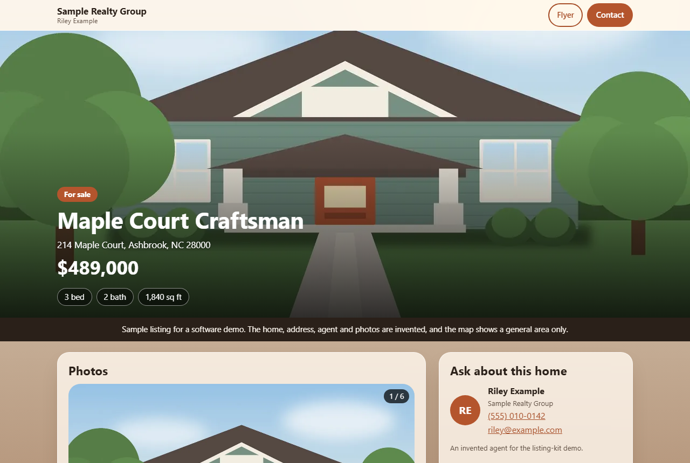
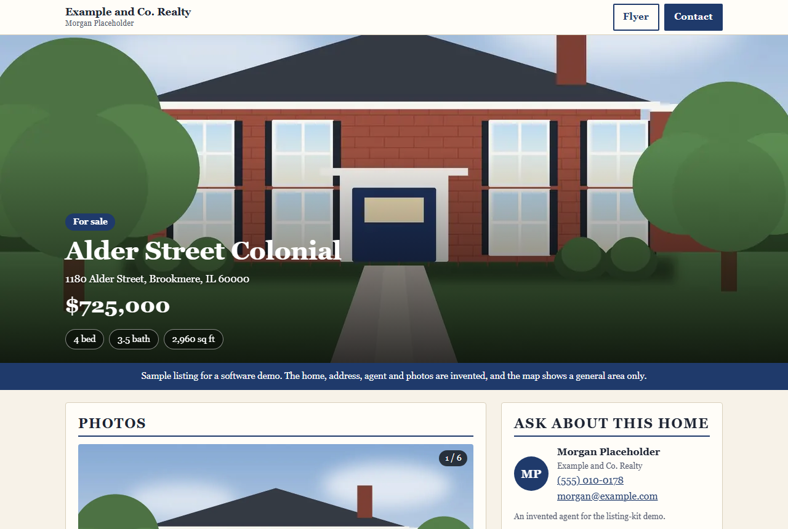
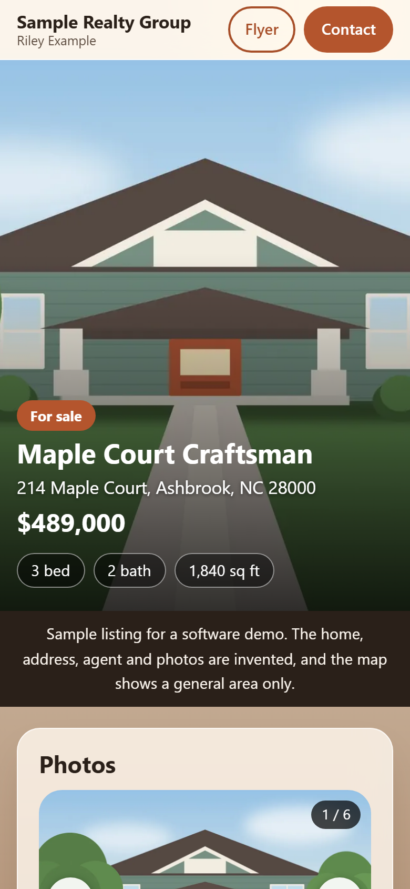
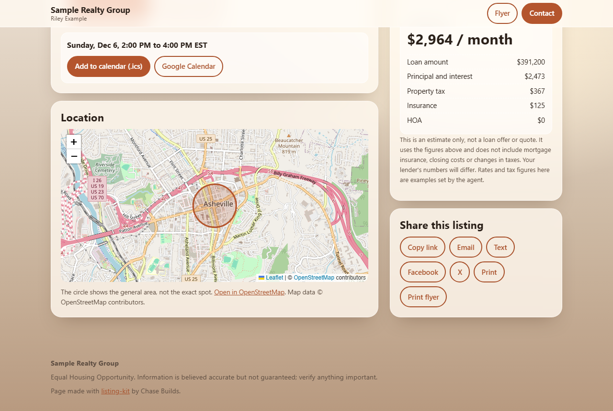
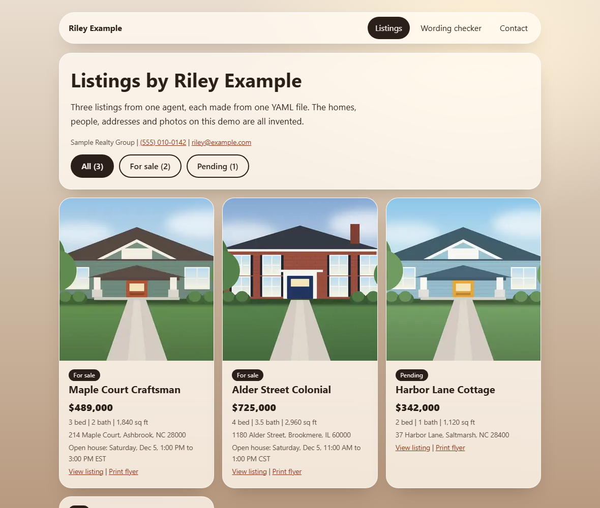
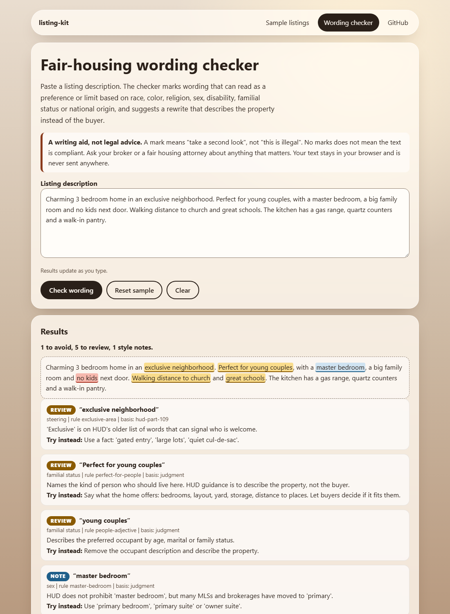

# listing-kit

[](https://github.com/chasebuilds/listing-kit/actions/workflows/ci.yml) [](https://chasebuilds.github.io/listing-kit/)  [](LICENSE)

**One YAML file in, one fast listing website out, for real estate agents.** You fill in the price, photos, open house times and your contact details. You get a page that works on phones, with a photo gallery, map, payment estimate, open house calendar files, contact form, share buttons and a print flyer. Several listings also get a "my listings" index page. A built-in checker flags listing wording that can break fair housing advertising rules.

**Live demo:** [my listings page](https://chasebuilds.github.io/listing-kit/) | [glass theme](https://chasebuilds.github.io/listing-kit/maple-court/) | [heritage theme](https://chasebuilds.github.io/listing-kit/alder-street/) | [coastal theme, pending sale](https://chasebuilds.github.io/listing-kit/harbor-lane/) | [wording checker](https://chasebuilds.github.io/listing-kit/checker/)



**Measured:** Lighthouse on the live demo (median of 3 runs per page, mobile and desktop): 100 for performance, accessibility, best practices and SEO on the index, all three listings and the checker, with mobile LCP 0.8 to 1.3 seconds; single runs sometimes scored lower, see [docs/LIGHTHOUSE.md](docs/LIGHTHOUSE.md). The wording checker scores 95.2% precision and 63.5% recall on 143 sentences written after its rules were frozen (96.8% and 96.8% on the 258 it was tuned on). Full tables and every miss: [BENCHMARK.md](BENCHMARK.md). The checker is a writing aid, not legal advice.

Every home, address, agent and photo in the demo is invented. The photos are illustrations drawn by a script in this repo.

## Make your own listing page in 3 steps

You need Python 3.11 or newer.

```
git clone https://github.com/chasebuilds/listing-kit.git
cd listing-kit
pip install .
```

1. **Start a file.** `listing-kit init my-home.yml` writes a commented starter. Fill in the price, beds, baths, square feet, description, features, open house times, your contact details and the map coordinates. Put your photos in the same folder and list them under `photos:`, each with a short description (alt text).
2. **Build it.** `listing-kit build my-home.yml -o site` writes the finished page to the `site` folder. Open `site/index.html` to look at it. The command also prints any wording notes from the checker and how much the photos shrank.
3. **Put it online.** Upload the `site` folder to any static host (GitHub Pages, Netlify and Cloudflare Pages all have free plans). Add `site_url:` to the YAML with the final address so link previews on social sites and in text messages show your photo.

Two or more listings: `listing-kit build a.yml b.yml c.yml -o site --index-config index.yml` builds one page per listing plus an index page with your name, a status filter (All, For sale, Pending...) and a card for each home. See [`examples/`](examples) for three finished listings and the `index.yml` behind the demo. On Windows use `.venv\Scripts\` in front of the commands if you installed into a virtual environment.

## What each page has

| Part | What it does |
|---|---|
| Hero | The first photo, status, price, address, beds, baths and square feet |
| Photo gallery | Swipe or use the arrow buttons or keys; tap a photo for a full-screen viewer with captions, arrow keys and swipe |
| Key facts | Price, beds, baths, living area, price per square foot, lot, year built, HOA |
| Features | A list in two columns |
| Open house | Each time has an Add to calendar (.ics) file and a Google Calendar link; ended events are marked |
| Map | Leaflet with OpenStreetMap tiles and attribution; loads only when scrolled near; can show a general-area circle instead of an exact pin |
| Payment estimate | Inputs for price, down payment, rate, term, tax and insurance; shows the loan amount and a monthly breakdown; labeled as an estimate and not a quote |
| Contact form | Works with no backend: opens the visitor's email app with the message filled in, or posts to a form service you choose |
| Share | Copy link, native share on phones, email, text, Facebook, X |
| Print flyer | `flyer.html`, one US letter page with the photos, facts, description, open houses and your contact details; the main page also prints cleanly |
| Link previews | Open Graph and Twitter card tags with a 1200 by 630 photo, plus schema.org data |
| Accessibility | Skip link, labeled fields, alt text required, 44 pixel touch targets, keyboard gallery and viewer, readable link colors on any brand color, reduced-motion support |

Three themes: `glass` (frosted panels), `heritage` (serif, navy) and `coastal` (light, teal). The agent's `brand_color` sets buttons and accents. Link colors are darkened automatically when a brand color would be hard to read.

| glass | heritage |
|---|---|
|  |  |

On a phone, and the map section:

| Phone | Map |
|---|---|
|  |  |

## Photos: resized for you

Give it your full-size photos. At build time every photo is resized to WebP at 640, 1280 and up to 1920 pixels wide (never enlarged), listed in a `srcset` so a phone downloads a small copy and a desktop a bigger one. Every image tag has its width and height set so the page does not jump while loading. The hero loads first with high priority; the rest of the gallery loads lazily. A 1200 by 630 link-preview image and a card thumbnail are made too.

Re-encoding also removes EXIF data, including any GPS position and camera details, from what gets published. The original files are not published. A rebuild clears out photos from earlier builds.

Measured on the demo (`listing-kit build` prints this for your own photos): the 6 photos of the Maple Court listing are 364 KB as drawn, 197 KB across all sizes written, and the 640 pixel copies alone total 30 KB. These demo images are flat illustrations, so real camera photos start much larger.

## The "my listings" page

When you build more than one YAML file, the output folder gets an `index.html` that works as an agent's listings page: your name and contact line, a filter by status (shown when the listings differ), and a card for each home with its photo, price, beds, baths, square feet, address, next open house (hidden once it has passed), a link to the page and a link to the flyer. Options:

```
listing-kit build a.yml b.yml c.yml -o site --index-config index.yml --sort price-desc --checker
```

`--sort` takes `file` (the order you list them), `price-asc`, `price-desc` or `title`. `index.yml` holds a `title`, an optional `intro` and an `agent` block (name, brokerage, phone, email); see [`examples/index.yml`](examples/index.yml). One listing builds at the top of the output folder with no index.



## The fair housing wording checker

Listing text can break the Fair Housing Act without anyone meaning to. Phrases like "perfect for young couples", "no kids" or "walking distance to church" describe the buyer instead of the home. The checker scans a description and shows the phrase, why it can read as a preference, and a rewrite.

**This is a writing aid, not legal advice.** A flag means "take a second look", not "this is illegal". No flags does not mean the text is compliant. Laws differ by state and city, and context matters. Ask your broker or a fair housing attorney about anything that matters.

Use it three ways:

```
listing-kit check "Perfect for young couples. No kids."      # text on the command line
listing-kit check --file description.txt                     # a file (or pipe text in)
listing-kit check --json "..."                               # machine-readable
```

The command exits with 1 when it finds an `avoid` or `review` flag, so it can run in a script or CI. `--no-fail` always exits 0. `listing-kit build` runs the same check on your title, description and features and prints what it finds. The [in-page checker](https://chasebuilds.github.io/listing-kit/checker/) does the same in a browser. Text never leaves the page.

Example output:

```
[review] 'Perfect for young couples'  (familial_status, rule perfect-for-people)
    why: Names the kind of person who should live here. HUD guidance is to describe the property, not the buyer.
    try: Say what the home offers: bedrooms, layout, yard, storage, distance to places. Let buyers decide if it fits them.
[avoid] 'No kids'  (familial_status, rule no-children)
    why: Says children are not wanted. Familial status (children under 18 in the household) is a protected class.
    try: Remove it. Describe the home itself, for example the number of bedrooms and the layout.
```



### How it decides

The rules are in one readable file, [`src/listing_kit/data/rules.yml`](src/listing_kit/data/rules.yml). Each rule has a protected class, a severity, a regular expression, a reason and a suggested rewrite. You can pass your own file with `--rules`.

| Severity | Meaning |
|---|---|
| `avoid` | States or clearly signals a preference or limit. Rewrite it. |
| `review` | Often reads as a preference. Check the context. |
| `note` | Style advice only. Not counted as a flag. |

Each rule also records its `basis`: `hud-1995-memo` (the wording is an example in the HUD memo), `hud-part-109` (a word on HUD's older advertising word list), `statute` (plain preference language under the Act) or `judgment` (this project's own conservative reading). The `judgment` rules go further than HUD's published examples, and the page says so.

### Opt-in pack: state and local law (off by default)

Some wording is lawful federally but banned in many states and cities. Refusing housing vouchers ("no Section 8") or limiting income to wages are the main cases. These are **state and local law, not federal**, so they are not in the default checks. They live in a separate rule pack marked `pack: local` in the rules file, and run only when you ask:

```
listing-kit check --pack local "No Section 8."      # flagged only with the pack on
```

On the checker page, tick "Also check state and local law items". Your state's list may be longer or shorter than this one, and the pack covers only these two rules. They are scored on their own in BENCHMARK.md and kept out of the main precision and recall numbers.

### Policy choices, so you know what to expect

- "Family room", "single-family" and "multi-family" are fine. They describe the house.
- "Master bedroom" is not flagged. HUD's memo says the term is not a violation. The checker adds a style note because many MLSs now say "primary bedroom".
- "Mother-in-law suite" and "bachelor apartment" are described by HUD as common physical descriptions. The checker gives a style note for the first and flags only sales-pitch uses such as "bachelor pad".
- Describing accessibility features ("wheelchair ramp", "step-free entry") and conduct rules ("non-smoking", "sober living") is fine.
- Naming a school as a fact is fine. Quality claims ("great schools") are flagged because they can steer buyers and go stale. HUD's memo does not list this; it is a judgment rule.
- Naming a place of worship as a selling point ("walking distance to church") is flagged for review. The memo says plainly describing a facility is lawful, so this is also a judgment rule.
- "Desirable neighborhood" and "safe neighborhood" get a note only. The memo says complaints about "desirable neighborhood" should not be filed.

### Sources

- Fair Housing Act, section 804(c), [42 U.S.C. 3604(c)](https://www.law.cornell.edu/uscode/text/42/3604): it is unlawful to publish any notice, statement or advertisement for the sale or rental of a dwelling that indicates a preference, limitation or discrimination based on race, color, religion, sex, handicap (disability), familial status or national origin.
- [24 CFR 100.75](https://www.ecfr.gov/current/title-24/subtitle-B/chapter-I/subchapter-A/part-100/subpart-B/section-100.75), HUD's regulation on discriminatory advertisements, statements and notices.
- HUD memorandum, January 9, 1995, from Roberta Achtenberg, Assistant Secretary for Fair Housing and Equal Opportunity: "Guidance Regarding Advertisements Under Section 804(c) of the Fair Housing Act" (hud.gov document DOC_7784; HUD has since moved its site, so the link below is an archived copy). It gives examples such as "white family home", "no Irish", "no Jews", "Christian home" and "no wheelchairs", and a rule that ads may not "state a preference for adults, couples or singles". It also says phrases such as "master bedroom" and "desirable neighborhood" are facially neutral. [Archived copy](https://web.archive.org/web/20250220183223/https://www.hud.gov/sites/documents/doc_7784.pdf).
- 24 CFR Part 109 (HUD's older Advertising Guidelines, removed from the CFR in 1996). Its word list included "exclusive", "restricted", "private", "integrated" and "traditional". The memo above says those guidelines had been read to reach further than HUD intended, so the checker treats these as review flags, not violations.

## Measured results

### Wording checker

Scored on 401 invented sentences (plus 18 for the opt-in pack). They were written by the same person who wrote the rules, so real listings will be messier. The full tables, every miss and every false alarm are in [BENCHMARK.md](BENCHMARK.md), written by `py benchmark/evaluate.py`.

| Set | Sentences | Precision | Recall |
|---|---|---|---|
| dev (everything the rules were tuned on) | 258 | 96.8% | 96.8% |
| held-out (new in 1.1.0, written after the rules were frozen) | 143 | 95.2% | 63.5% |
| all | 401 | 96.4% | 85.6% |

Trust the held-out row. The 1.0.0 held-out set (72.3% recall) was folded into dev once its misses were used to write new rules, so the new set is a fresh test; its recall is lower because it was written to be varied and includes many paraphrases the rules cannot see. In plain terms: about 1 flag in 20 is a false alarm, and about 1 problem sentence in 3 is missed. The misses are listed in BENCHMARK.md and are the next rules to add, to be checked against yet another fresh set.

### Pages

Lighthouse on the live demo, median of 3 runs per cell: performance, accessibility, best practices and SEO are all 100 on the index, the three listings and the checker, mobile and desktop. Mobile LCP is 0.8 to 1.3 seconds. Individual runs sometimes scored lower (lowest 92 for performance and SEO, one earlier pass much lower), and two runs failed to paint and were dropped. The full table, the spread and the causes are in [docs/LIGHTHOUSE.md](docs/LIGHTHOUSE.md).

## The YAML file

[`src/listing_kit/data/listing.schema.json`](src/listing_kit/data/listing.schema.json) is the full schema; `listing-kit validate my-home.yml` checks a file and lists every problem at once.

| Field | Required | Notes |
|---|---|---|
| `title`, `address` (street, city, region, postal_code) | yes | |
| `price`, `beds`, `baths`, `sqft` | yes | `baths` may use halves (2.5) |
| `description` | yes | Blank lines start new paragraphs. Checked by the wording checker. |
| `photos` | yes | List of `file`, `alt`, optional `caption`. The first is the hero. |
| `agent` | yes | `name`, `email`; optional `brokerage`, `phone`, `license`, `tagline`, `brand_color` |
| `location` | yes | `lat`, `lng`; optional `zoom`, and `approximate: true` for a circle instead of a pin |
| `theme` | no | `glass` (default), `heritage`, `coastal` |
| `features`, `lot_sqft`, `year_built`, `hoa_monthly`, `status`, `slug` | no | `status` is free text (For sale, Pending, Sold...) and drives the index filter |
| `open_houses` | no | `start` and `end` as `YYYY-MM-DD HH:MM` in `timezone` (default `America/New_York`), optional `note` |
| `lead` | no | `mode: mailto` (default) or `mode: endpoint` with an `https://` `endpoint` |
| `mortgage` | no | Starting values for the estimate: `down_payment_pct`, `rate_pct`, `term_years`, `tax_rate_pct`, `insurance_per_year` |
| `site_url` | no | Where the page will live; sets the canonical link and absolute link-preview URLs |
| `notice` | no | A banner line, used on the demo pages to say they are invented |

### The contact form

With `mode: mailto` the form works on any static host: submitting opens the visitor's email app with a filled-in message to the agent. Nothing is stored. (It needs JavaScript; without it the page shows a plain email link.) With `mode: endpoint` the form posts to a form service such as Formspree or Getform; set `endpoint` to its URL. If the post fails, the page shows a message and an email link. A hidden honeypot field catches simple bots.

### The payment estimate

The widget computes principal and interest with the standard loan formula, then adds property tax (a percentage of the price per year), insurance and HOA dues. It does not include mortgage insurance, closing costs or changes in taxes, and it says so on the page. The starting rate and tax figures are examples set in the YAML, not market data. The same formula is in Python and JavaScript, and a test checks that they agree.

## Only the checker

```
listing-kit checker-page -o checker        # just the in-page checker, with its scripts
listing-kit build a.yml b.yml -o site --checker   # listings, index and /checker together
```

The demo site is built this way by [`.github/workflows/pages.yml`](.github/workflows/pages.yml).

## Privacy and third parties

The pages set no cookies and have no analytics, ad scripts or web fonts. The only outside requests are map tiles from OpenStreetMap when the map scrolls into view, and the share and Google Calendar links, which only open when clicked. Leaflet 1.9.4 (BSD 2-Clause, see `src/listing_kit/static/leaflet/LICENSE`) is included in the output so the map does not depend on a CDN.

## Develop

```
python -m venv .venv
.venv\Scripts\python -m pip install -e ".[dev]"
.venv\Scripts\python -m ruff check .
.venv\Scripts\python -m pytest
.venv\Scripts\python benchmark\evaluate.py        # rewrites BENCHMARK.md
```

The tests check the YAML schema (good and bad files), the `.ics` output (time zones, escaping, line folding), every checker rule (each one has a sentence that must trigger it), the policy cases above, the opt-in pack, image resizing (sizes, no upscaling, width and height match the files, lazy loading, EXIF removal), the index page (cards, sorting, filter, config checks), the built pages (accessibility basics, link-preview tags, JSON data, script escaping) and that the in-page JavaScript gives the same results as Python on every benchmark sentence, with and without the local pack. `tests/browser_smoke.cjs` drives the built demo in a real browser: gallery, viewer, payment estimate, form, map, checker, pack checkbox and index filter. CI runs all of it on Python 3.11 and 3.13.

Layout: `src/listing_kit/` (build, config, ics, mortgage, fairhousing, cli, templates, themes, static scripts), `examples/`, `benchmark/`, `tests/`, `scripts/` (sample photo drawing, screenshots).

## Limits

See [LIMITATIONS.md](LIMITATIONS.md).

## License

MIT, see [LICENSE](LICENSE). Built by Chase Builds.

## More from Chase Builds

- **[seller-net-sheet-cma](https://github.com/chasebuilds/seller-net-sheet-cma)**: Seller net sheet, buyer cash to close and a CMA presentation in one page. 20,000 of 20,000 prorations correct to the cent. ([live demo](https://chasebuilds.github.io/seller-net-sheet-cma/))
- **[showing-route-planner](https://github.com/chasebuilds/showing-route-planner)**: Orders a day of showings around every listing window with the least driving. Works offline on a phone. ([live demo](https://chasebuilds.github.io/showing-route-planner/))
- **[comparable-sales-grid](https://github.com/chasebuilds/comparable-sales-grid)**: Picks comps, adjusts each line with rates measured from your own sales, and gives a value range. Within 5% on 93.0% of test homes. ([live demo](https://chasebuilds.github.io/comparable-sales-grid/))

[All projects, sorted by industry](https://github.com/chasebuilds) · [chasebuilds.github.io](https://chasebuilds.github.io)
